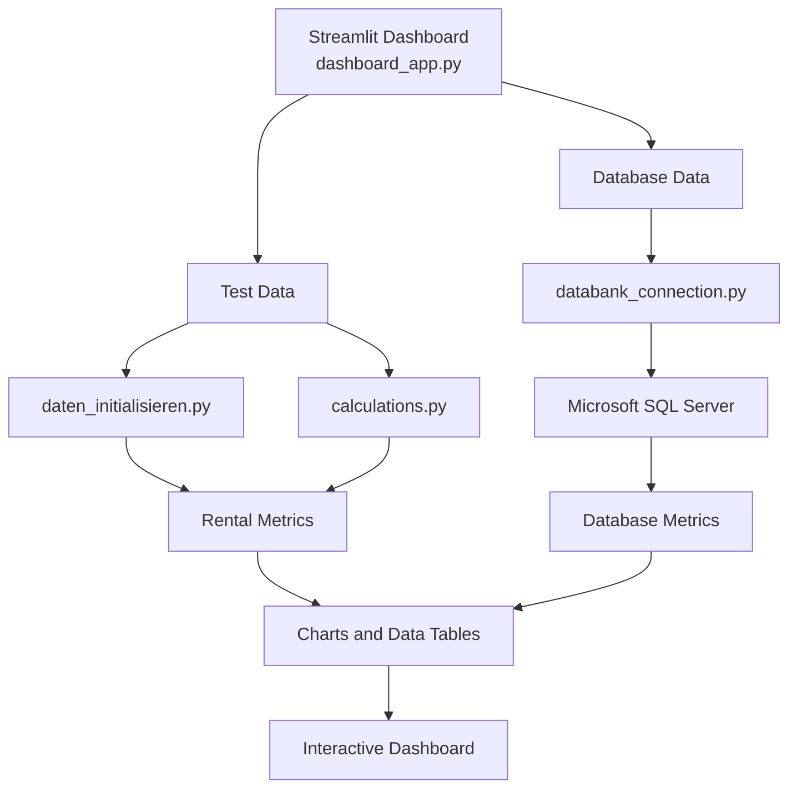

# 🎵 Musical Instrument Rental Dashboard and User Interface


&#x20;   An interactive dashboard for managing and analyzing musical instrument rentals.
Expanding the SQL project https://github.com/PStaus/SQL-Music-Instrument-Rental-Projekt 


---

## 📌 Project Overview

The Musical Instrument Rental Dashboard is an interactive Streamlit application developed to support the analysis and management of a musical instrument rental business.

The dashboard combines test data and information retrieved from a Microsoft SQL Server database. It calculates key business metrics, visualizes rental and customer data, and provides functionality for checking instrument availability for a selected booking date.

The application is designed to make rental information easier to understand and to provide a clear overview of important business figures.


## ✨ Key Features

### 1. Test Data Dashboard

The first dashboard tab uses test data initialized in `daten_initialisieren.py`.

It provides an overview of important rental metrics:

- **Average rental duration:** Calculates the mean duration of instrument rentals in days.
- **Total rental revenue:** Calculates the total revenue based on rental duration and daily rental prices.
- **Currently rented instruments:** Counts instruments that have not yet been returned.

The displayed data can be filtered to show only currently open rentals.

**Data visualization:**

- Stacked bar chart created with pandas and Matplotlib, showing rental frequencies by instrument group and instrument type.
- Interactive bar chart created with Plotly, comparing rental frequencies across instrument groups and instrument types.
- Data table displaying the underlying rental records.

### 2. Instrument Selection and Availability

The application also provides functionality for checking instrument availability.

Users can:

1. Select an instrument type.
2. View the corresponding instruments and their condition.
3. Select a preferred booking start date.
4. Check which instruments of the selected type are available for that date.

The availability calculation is implemented in `calculations.py`. It checks whether the selected date falls within an instrument's rental period. If an actual return date is not available, the planned return date is considered.


### 3. Database Dashboard

The second dashboard tab retrieves data from the Microsoft SQL Server database.

It displays key business metrics based on database tables and views:

- Average rental duration.
- Total rental revenue.
- Number of instruments currently rented.

The dashboard also includes two customer-related views:

- **Customer List:** Displays the customer records retrieved from the database.
- **Customer Groups:** Visualizes the distribution of customers by customer type using a Plotly bar chart.


### 4. Adding New Customers

The database dashboard allows users to add a new music band to the SQL Server database.

The application:

1. Accepts a new band name through a text input.
2. Executes a parameterized SQL `INSERT` statement.
3. Commits the change to the database.
4. Reloads the database module to refresh the displayed data.
5. Displays a confirmation message after successful insertion.

---


## 🛠️ Technologies Used

| Technology           | Purpose                                    |
| -------------------- | ------------------------------------------ |
| Python               | Main programming language                  |
| Streamlit            | Interactive dashboard and user interface   |
| pandas               | Data processing, filtering and aggregation |
| Plotly Express       | Interactive data visualizations            |
| Matplotlib           | Stacked frequency plots                    |
| Microsoft SQL Server | Relational database                        |
| pyodbc               | Python connection to SQL Server            |
| datetime             | Date and rental duration calculations      |

## 🏗️ Project Structure

The application is organized into separate Python modules to distinguish the dashboard interface, calculations, test data and database connection.

```text
project/
│
├── dashboard_app.py
│   └── Main Streamlit application
│
├── calculations.py
│   └── Custom calculation and visualization functions
│
├── daten_initialisieren.py
│   └── Initialization of test data
│
├── databank_connection.py
│   └── Database connection and data retrieval
│
└── README.md
```

### Main Python Modules

**`dashboard_app.py`**

The main application file. It creates the Streamlit interface, displays the two dashboard tabs, calculates key metrics and connects the user interface with the other modules.

**`calculations.py`**

Contains custom functions for data analysis and visualization:

- `stacked_freq_plot()` creates stacked frequency plots.
- `check_date()` checks whether a date falls within a rental period.
- `show_available_instruments()` filters instruments based on type and availability.

**`daten_initialisieren.py`**

Provides the test data used in the first dashboard tab.

**`databank_connection.py`**

Provides access to the Microsoft SQL Server database and the data used in the second dashboard tab.

## 🔄 Application Architecture

The application separates the user interface, calculation logic and data sources.




## 📊 Dashboard Overview

The application provides two main areas:

| Test Data                              | Database                                    |
| -------------------------------------- | ------------------------------------------- |
| Uses initialized test data             | Uses data from SQL Server                   |
| Displays rental metrics                | Displays database-based rental metrics      |
| Provides rental charts and data tables | Provides customer charts and customer lists |
| Checks instrument availability         | Allows adding new music bands               |

## 🎯 Project Objectives and Learning Outcomes

This project demonstrates the practical application of Python-based data analysis and dashboard development.

Key learning objectives include:

- Developing an interactive dashboard with Streamlit.
- Processing and analyzing structured data with pandas.
- Creating visualizations with Plotly and Matplotlib.
- Connecting a Python application to Microsoft SQL Server using pyodbc.
- Retrieving and displaying database information.
- Executing SQL statements from a Python application.
- Implementing custom functions for rental period and instrument availability calculations.
- Presenting business metrics in a clear and accessible way.

## 🔮 Possible Future Improvements

Potential extensions of the application include:

- Adding additional user interface for implemented SQL database logic
- Improving error handling and input validation.

## 👩‍💻 Author

**Paulina Staus**

*Project date: January 2026*

---

\<p align="center">   \<i>Turning rental data into meaningful business insights.\</i> \</p>
